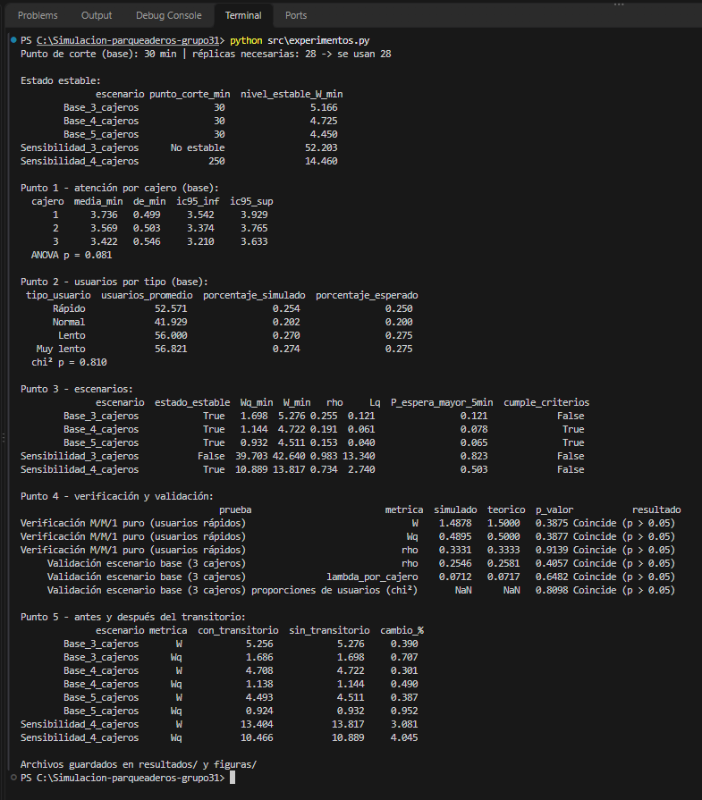

# Simulación del sistema de pago de parqueaderos — Centro Comercial Supercentro

Simulación de eventos discretos de los cajeros de pago de un punto de salida (colas M/M/1 independientes)
para decidir si tres cajeros son suficientes, con determinación del estado estable, eliminación del
estado transitorio y verificación/validación frente a la teoría M/M/1.

Actividad didáctica 2-M4 — Simulación, IU Digital de Antioquia. Grupo 31:
Gilliam Argel Monterroza, Leydi Correa Herrera, Sergio Andrés Agudelo Marulanda, Arley Steven Franco Galeano.

## Estructura

```
├── src/
│   ├── parqueadero.py    # Modelo: parámetros, generación de llegadas, simulación y teoría M/M/1
│   └── experimentos.py   # Estado estable, réplicas, escenarios, Puntos 1-5, tablas y gráficas
├── resultados/
│   ├── resultados_parqueaderos.xlsx   # todas las tablas (una hoja por punto)
│   └── clientes.csv                   # un registro por cliente simulado
├── figuras/              # gráficas en 300 dpi (Matplotlib)
└── requirements.txt
```

## Instalación y ejecución

```bash
git clone https://github.com/sergioagudelo58-rgb/simulacion-parqueaderos-grupo31.git
cd simulacion-parqueaderos-grupo31
pip install -r requirements.txt
python src/experimentos.py
```

Tarda unos 10 segundos e imprime en consola el resumen de cada punto.

## Parámetros del sistema

| Tipo de usuario | Porcentaje | Media de servicio (min) | Media entre llegadas (min) |
|---|---|---|---|
| Rápido | 25 % | 1 | 3 |
| Normal | 20 % | 3 | 3 |
| Lento | 27.5 % | 4 | 5 |
| Muy lento | 27.5 % | 6 | 7 |

Todos los tiempos son exponenciales. Cada réplica simula 1000 minutos.

## Supuestos (decisión del grupo)

1. **Escenario base — un solo flujo de llegadas:** al llegar un cliente se sortea su tipo según los porcentajes
   y el tiempo hasta la siguiente llegada usa la media de ese tipo. Es la única lectura en la que se cumplen
   los porcentajes del enunciado (en promedio llega un cliente cada 4.65 min).
2. **Escenario de sensibilidad — un flujo independiente por tipo:** cada tipo llega con su propia media, como
   calcula el laboratorio (≈ 1 cliente por minuto). Se usa para ver qué pasa con una demanda mucho mayor.
3. Cada cliente se asigna al azar a uno de los cajeros; cada cajero tiene su propia fila (FIFO), sin cambio de
   fila ni deserción.

## Escenarios

| Escenario | Llegadas | Cajeros |
|---|---|---|
| Base_3_cajeros | Un solo flujo | 3 (situación actual) |
| Base_4_cajeros / Base_5_cajeros | Un solo flujo | 4 / 5 |
| Sensibilidad_3_cajeros / Sensibilidad_4_cajeros | Flujo por tipo | 3 / 4 |

## Método

- **Estado estable:** 20 réplicas piloto; tiempo promedio en el sistema por intervalos de 10 min y promedio móvil
  de 5 intervalos. El periodo de calentamiento termina cuando el promedio móvil llega al 95 % de su nivel estable
  (media de la segunda mitad de la corrida). Si la curva sigue creciendo, el escenario no tiene estado estable.
- **Número de réplicas:** n = (t · s / (0.05 · media))², con el tiempo en el sistema del escenario base sin transitorio.
- **Semillas:** la réplica r usa la semilla `1000 + r`; los resultados son idénticos en cada ejecución.
- **Verificación:** un cajero con solo usuarios rápidos es un M/M/1 puro (λ = 1/3, μ = 1); se compara con la teoría
  (W = 1.5 min, Wq = 0.5 min, ρ = 1/3) mediante una prueba t.

## Hojas del Excel y gráficas

| Hoja | Contenido | Gráfica |
|---|---|---|
| `parametros` | Réplicas, duración, punto de corte y pruebas estadísticas | — |
| `estado_estable` | Punto de corte y nivel estable de cada escenario | `fig_estado_estable.png` |
| `punto1_cajeros` | Tiempo de atención por cajero: media, DE, mínimo, máximo, IC 95 % | `fig_punto1_atencion_cajero.png` |
| `punto2_tipos` / `punto2_conteo_replica` | Usuarios por tipo, porcentajes y tiempos por tipo | `fig_punto2_usuarios_tipo.png` |
| `punto3_escenarios` | Wq, W, ρ, Lq y P(espera > 5 min) por escenario frente a los criterios | `fig_punto3_escenarios.png` |
| `punto4_validacion` | Verificación (M/M/1 puro) y validación del escenario base | `fig_punto4_verificacion.png` |
| `punto5_transitorio` | Promedios con y sin el estado transitorio | `fig_punto5_antes_despues.png` |
| `clientes` | Registro de cada cliente simulado | — |

## Reproducibilidad

Con las mismas semillas, ejecutar el script varias veces produce resultados idénticos.
Entorno probado: Python 3.13, numpy 2.5, pandas 3.0, scipy 1.18, matplotlib 3.11, openpyxl 3.1.

### Evidencia de ejecución


